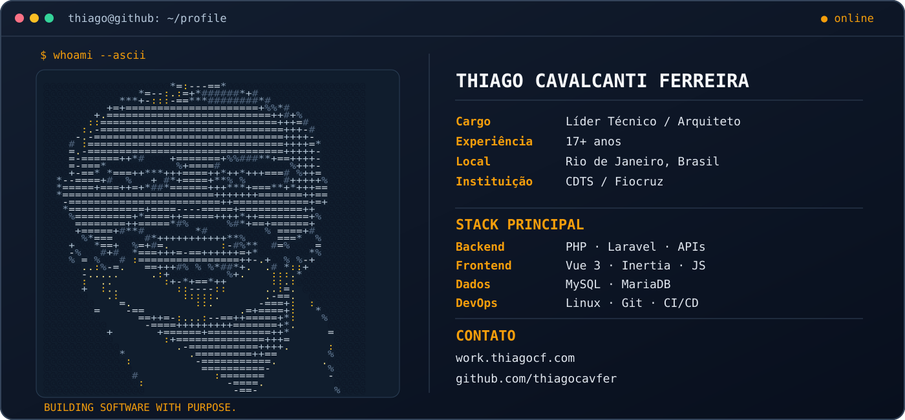

# Olá, eu sou o Thiago! 👋

**Líder Técnico de Desenvolvimento • Arquiteto de Software • Full Stack Developer**

*Transformando desafios complexos em soluções digitais robustas, escaláveis e centradas nas pessoas.*

## 👨‍💻 Sobre mim

Sou **Thiago Cavalcanti Ferreira**, desenvolvedor web com **mais de 17 anos de experiência**, com atuação em **arquitetura de software, liderança técnica, desenvolvimento full stack e integração de sistemas**.

Atuo no **CDTS / Fiocruz**, desenvolvendo e apoiando soluções tecnológicas voltadas à gestão, à pesquisa e à inovação em saúde pública. Minha experiência inclui definição de arquiteturas, orientação técnica de equipes e entrega de aplicações web de ponta a ponta.

- 🏗️ **Arquitetura:** sistemas de gestão, aplicações web, APIs REST e integrações.
- 💻 **Stack atual:** PHP, Laravel, Inertia.js, Vue 3, Tailwind CSS e MySQL.
- ⚙️ **Engenharia:** Git, GitLab CI/CD, Linux, ambientes de produção e práticas de qualidade.
- 🎯 **Objetivo:** construir software sustentável, seguro, eficiente e realmente útil.
- 🌎 **Localização:** Rio de Janeiro, Brasil.

## 🧰 Tecnologias e ferramentas

## 🚀 Áreas de atuação

| 🏢 Sistemas de gestão | 🌐 Web e portais | 🧩 Arquitetura e integrações |
| :--- | :--- | :--- |
| Sistemas corporativos e fluxos de trabalho. | Portais institucionais e aplicações modernas. | APIs REST, integração e escalabilidade. |

## 📌 Experiência em destaque

- **Liderança técnica de desenvolvimento full stack — CDTS / Fiocruz:** definição de soluções, orientação de equipes, arquitetura e evolução de sistemas.
- **Coordenação de desenvolvimento de sistemas:** acompanhamento de entregas, alinhamento técnico e atendimento a demandas de negócio.
- **Desenvolvimento e análise de sistemas:** aplicações web, APIs, documentação e sustentação de soluções.

Explore minha trajetória profissional e os projetos selecionados no [meu portfólio](https://work.thiagocf.com/).

## 📊 GitHub em números

> As estatísticas acima são calculadas por um serviço externo com base nos dados públicos do GitHub. Podem demorar a atualizar ou ficar indisponíveis temporariamente. Não representam necessariamente todas as contribuições profissionais realizadas em repositórios privados ou institucionais.

## 📫 Vamos conversar?

Meu trabalho une **tecnologia, liderança e impacto real**. Para conhecer melhor minha trajetória, experiências e projetos:

🌐 **Site:** [work.thiagocf.com](https://work.thiagocf.com/)  
📧 **E-mail:** [thiagocavfer@gmail.com](mailto:thiagocavfer@gmail.com)  
💻 **GitHub:** [@thiagocavfer](https://github.com/thiagocavfer)

---

Feito com dedicação, propósito e boas linhas de código. ☕

