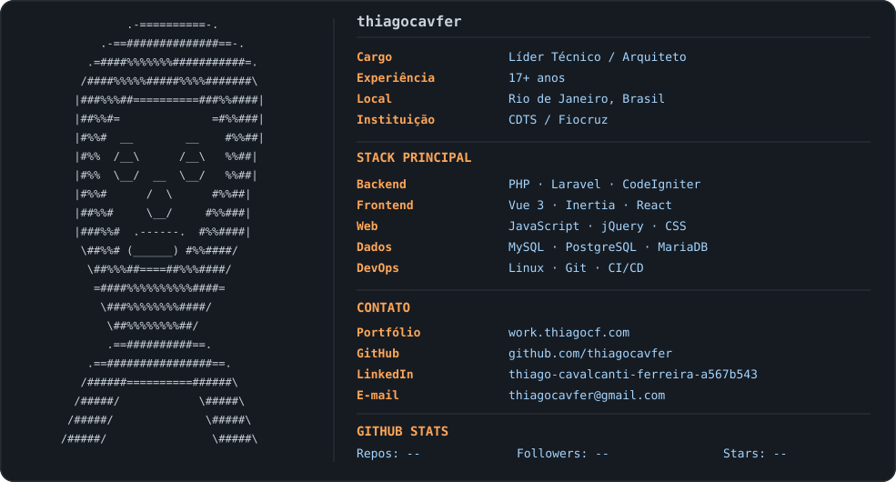

# Olá, eu sou o Thiago! 👋

**Líder Técnico de Desenvolvimento · Arquiteto de Software · Full Stack Developer**

*Building software with purpose.*

<a href="https://work.thiagocf.com/">Portfólio</a> · <a href="https://www.linkedin.com/in/thiago-cavalcanti-ferreira-a567b543">LinkedIn</a> · <a href="mailto:thiagocavfer@gmail.com">E-mail</a>

<a href="https://github.com/thiagocavfer/thiagocavfer">
  <picture>
    <source media="(prefers-color-scheme: dark)" srcset="dark_mode.svg">
    <source media="(prefers-color-scheme: light)" srcset="light_mode.svg">
    
  </picture>
</a>

<!-- As imagens SVG fazem a apresentação visual. Todo o conteúdo abaixo é texto real, selecionável, copiável e com links. -->

## 👨‍💻 Perfil profissional

Sou **Thiago Cavalcanti Ferreira**, profissional com **mais de 17 anos de experiência** em desenvolvimento web, arquitetura de software, liderança técnica e integração de sistemas. Atuo no **CDTS / Fiocruz**, contribuindo para soluções digitais de gestão, pesquisa e inovação em saúde pública.

| Informação | Detalhes |
| :--- | :--- |
| **Cargo** | Líder Técnico de Desenvolvimento / Arquiteto de Software |
| **Experiência** | 17+ anos |
| **Localização** | Rio de Janeiro, Brasil |
| **Instituição** | CDTS / Fiocruz |
| **Backend** | PHP, Laravel, CodeIgniter |
| **Frontend** | JavaScript, Vue 3, Inertia.js, React, jQuery, Tailwind CSS |
| **Banco de dados** | MySQL, PostgreSQL, MariaDB |
| **DevOps** | Linux, Git, GitLab CI/CD, Docker |

## 🚀 Áreas de atuação

**Arquitetura de software:** soluções sustentáveis, integrações e escalabilidade. **Liderança técnica:** orientação de equipes, qualidade de código e evolução arquitetural. **Engenharia full stack:** sistemas de gestão, APIs, sites e portais web.

## 🔗 Contato

- **Portfólio:** https://work.thiagocf.com/
- **GitHub:** https://github.com/thiagocavfer
- **LinkedIn:** https://www.linkedin.com/in/thiago-cavalcanti-ferreira-a567b543
- **E-mail:** thiagocavfer@gmail.com

## 📌 Repositórios

Os repositórios destacados abaixo da apresentação são definidos no próprio GitHub em **Customize your pins**.
